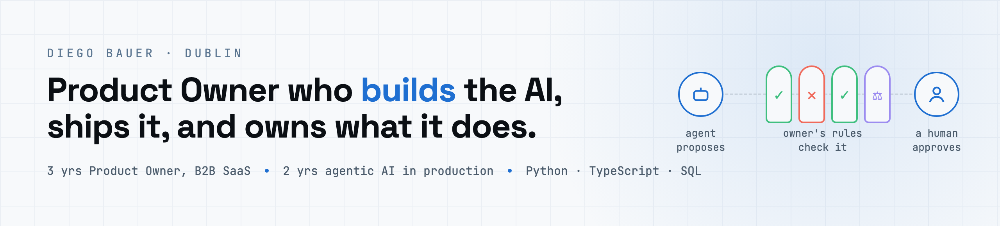
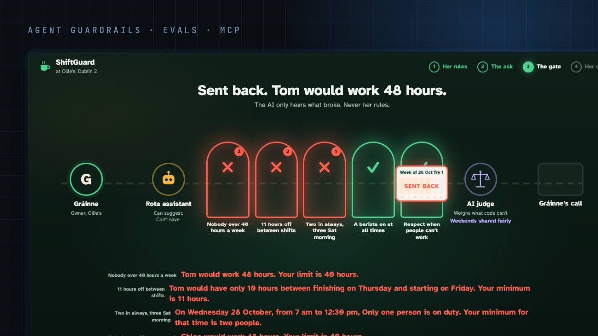
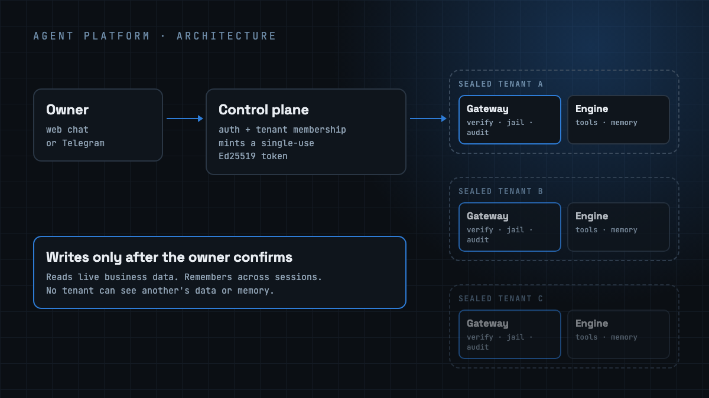
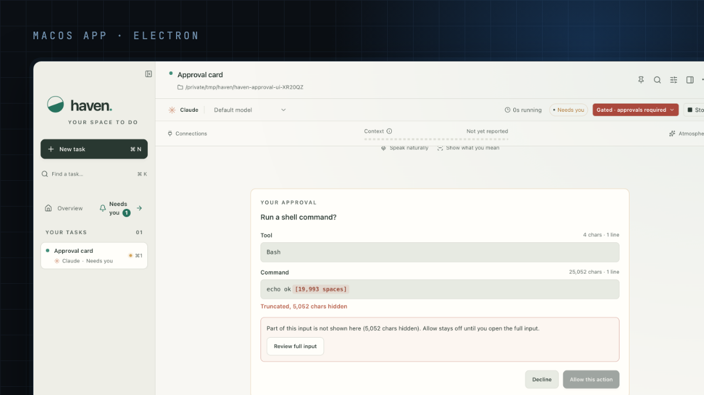
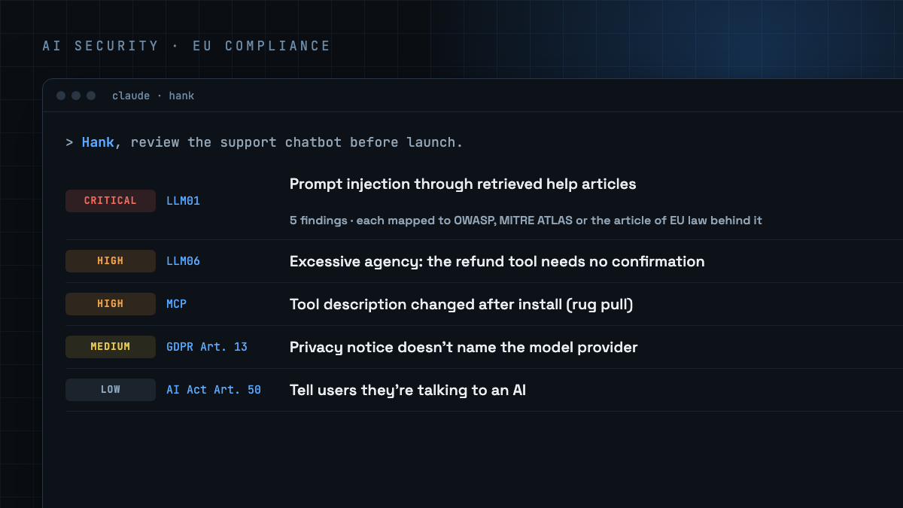
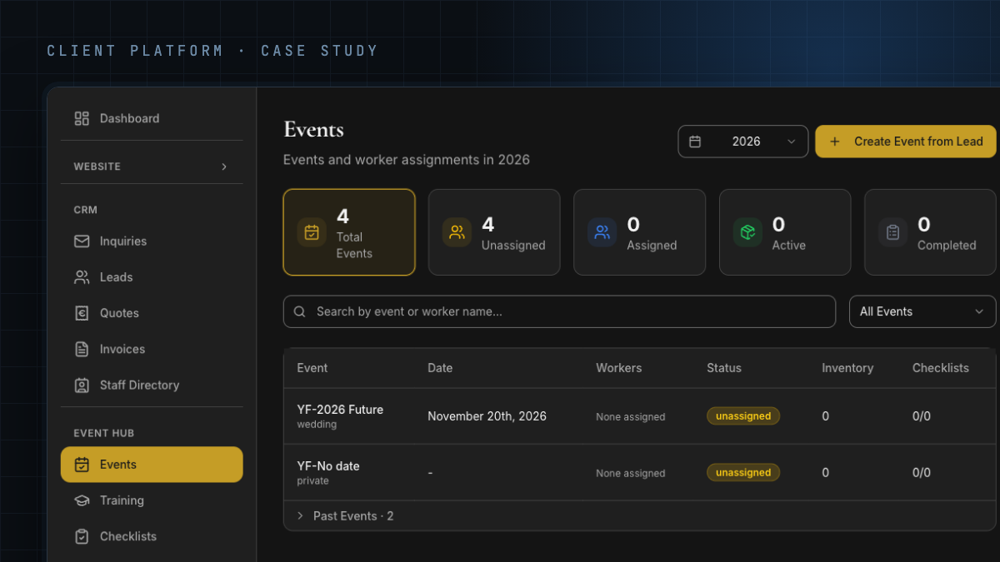
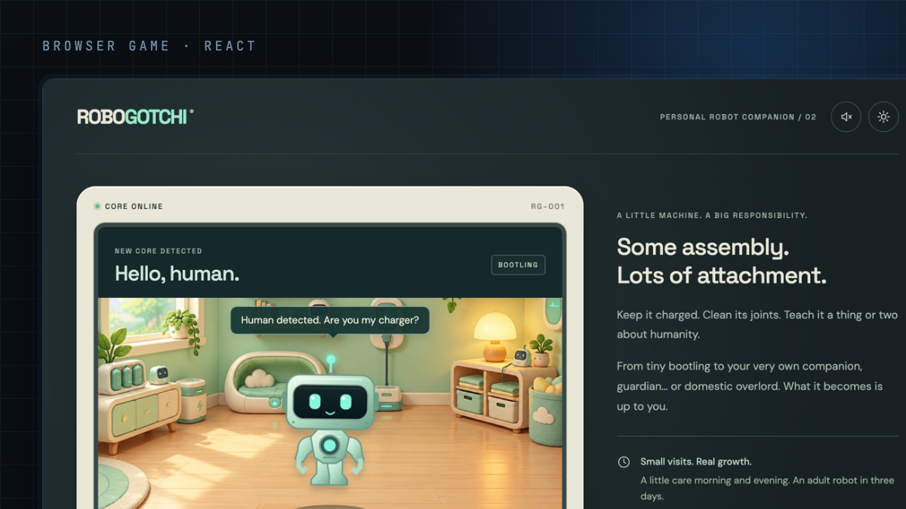

<a href="https://www.aiwithdiego.com">
  <picture>
    <source media="(prefers-color-scheme: dark)" srcset="assets/header-dark.png">
    
  </picture>
</a>

  
  

I build agentic AI systems that have run on real business data, and I work on both sides of them: the product decisions and the code. Most of what I build is about one question: **how do you let an agent act on a business without it doing something the owner wouldn't?**

**Latest:** [taste-to-evals](https://github.com/AIwithDiego/taste-to-evals), presented at AI Tinkerers Dublin, October 2026.

## Featured work

<table>
<tr>
<td width="50%" valign="top">

<h3><a href="https://github.com/AIwithDiego/taste-to-evals">taste-to-evals</a></h3>
An agent interviews a business owner, turns their rules into typed checks and an AI judge, and gates every change another agent proposes before a human approves. Presented at AI Tinkerers Dublin.
  
<code>TypeScript</code> <code>Claude</code> <code>MCP</code> <code>Evals</code>
</td>
<td width="50%" valign="top">

<h3><a href="https://github.com/AIwithDiego/aigentsmith-architecture">AIgentSmith architecture</a></h3>
Case study of the agent platform I designed and built for small businesses: an agent engine, a runtime gateway with signed single-use tokens, and a sealed unit per business.
  
<code>Architecture</code> <code>Security</code> <code>Multi-tenant</code>
</td>
</tr>
<tr>
<td width="50%" valign="top">

<h3><a href="https://github.com/AIwithDiego/haven">Haven</a></h3>
A calm macOS workspace for Claude Code, Codex and real terminals, side by side as named tasks, with an approval card before any risky action.
  
<code>Electron</code> <code>TypeScript</code> <code>Swift</code>
</td>
<td width="50%" valign="top">

<h3><a href="https://github.com/AIwithDiego/hank">Hank</a></h3>
An AI security and EU compliance analyst for Claude Code: OWASP LLM and Agentic Top 10 reviews, plus GDPR, AI Act, NIS2, CRA and DORA.
  
<code>Claude Code plugin</code> <code>OWASP</code> <code>EU law</code>
</td>
</tr>
<tr>
<td width="50%" valign="top">

<h3><a href="https://github.com/AIwithDiego/byjosem-case-study">ByJoseM case study</a></h3>
A custom operations platform for an Irish premium bartending business: CRM, quotes, invoices, stock and staff. Shipped continuously for a year.
  
<code>Client work</code> <code>Case study</code>
</td>
<td width="50%" valign="top">

<h3><a href="https://github.com/AIwithDiego/robogotchi">Robogotchi</a></h3>
A virtual pet in the browser: raise a robot in real time, teach it how to treat humans, and keep it alive. <a href="https://robogotchi-nine.vercel.app">Play it</a>.
  
<code>React</code> <code>TypeScript</code> <code>No backend</code>
</td>
</tr>
</table>

**Also built:** [attendance-mcp](https://github.com/AIwithDiego/attendance-mcp), an MCP server that lets an AI assistant analyse staff attendance with read-only tools · [Gym Routine Builder](https://github.com/AIwithDiego/gym-routine-builder), plan routines and run them set by set ([live](https://gym-routine-builder.vercel.app)).

Most of my production work is for clients and lives in private repos. The case studies describe those systems without the code.

## How I work

- **Design before code.** A written design doc before anything non-trivial, reviewed from product, architecture, QA and security angles.
- **Evals, not vibes.** Tests on everything that ships. For agent behaviour that means evals with deterministic checks.
- **Secure by default.** Auth and row-level security on anything that holds user data, secret scanning in CI, and an independent security review before release.

## Stack

         
