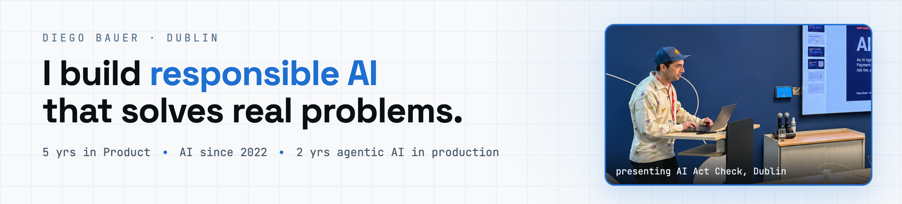
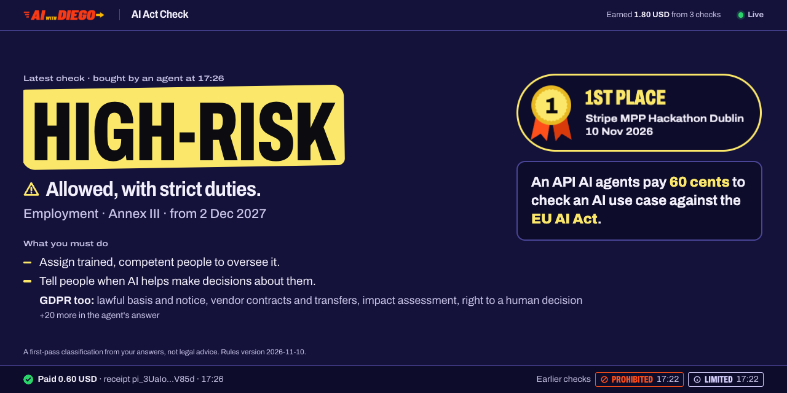
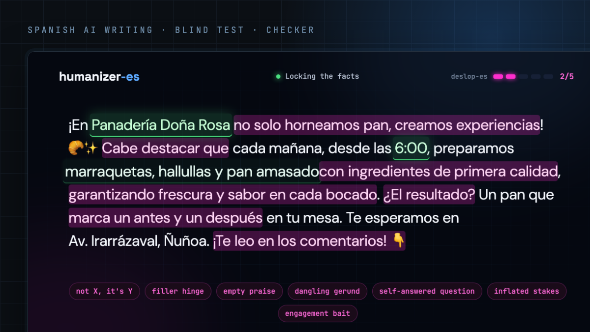
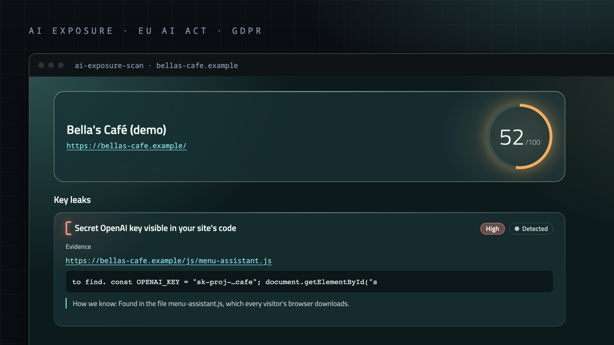
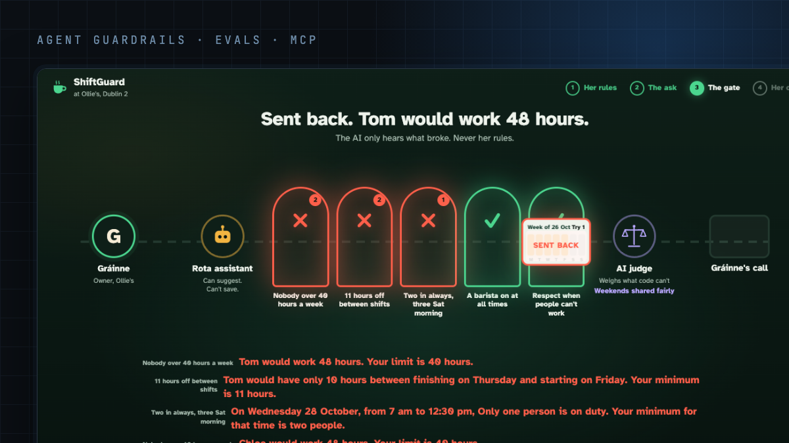
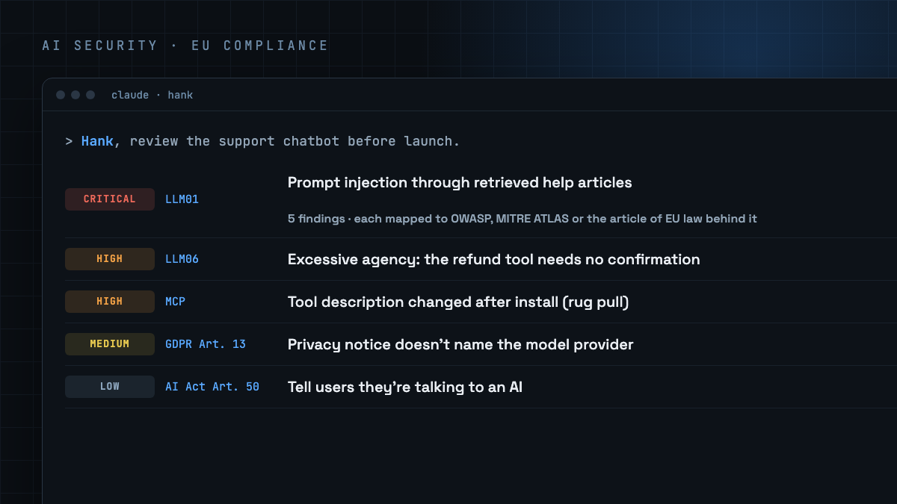
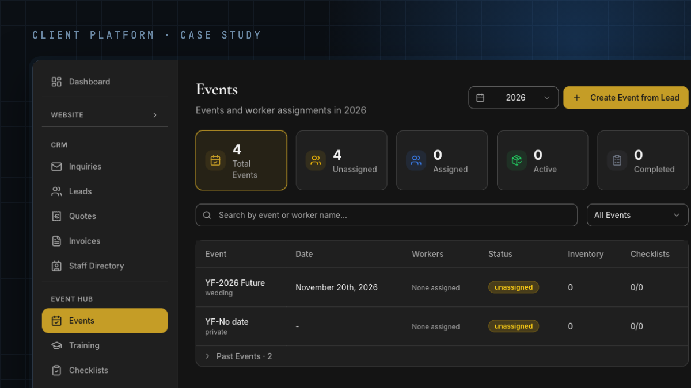

<a href="https://www.aiwithdiego.com">
  <picture>
    <source media="(prefers-color-scheme: dark)" srcset="assets/header-dark.png">
    
  </picture>
</a>

  
  

I start with people. I talk to the ones doing the work, research how it really runs, and find the problem worth solving. Then I decide what's worth making and, just as important, what isn't. I ship what has to be done and run it in production, owning both the product decisions and the code along the way.

Most of my work answers one question: **how do you let an agent act on a business without it doing something the owner wouldn't?** I design for the EU AI Act and GDPR from the start, and [Hank](https://github.com/AIwithDiego/hank), a security and compliance reviewer I made, checks my projects before they ship. AI governance keeps those rules enforced once the agent is live: the owner's rules run as evals on every change, and a human stays in the loop to approve before the agent acts.

**Latest:** [AI Act Check](https://github.com/AIwithDiego/ai-act-check), 1st place at the Stripe MPP Hackathon Dublin, 10 Nov 2026: an API that AI agents pay to check their code against the EU AI Act. Before it, [humanizer-es](https://github.com/AIwithDiego/humanizer-es), a humanizer for Spanish that ranked first of six in a blind test, and [AI Exposure Scan](https://github.com/AIwithDiego/ai-exposure-scan), built in a day with Devin at the Cognition x Give(a)Go build day, Dublin.

## Featured work

<table>
<tr>
<td width="50%" valign="top">

<h3><a href="https://github.com/AIwithDiego/ai-act-check">AI Act Check</a> · 1st place</h3>
An API AI agents pay 60 cents to check their code against the EU AI Act: tier, articles, duties by role and the GDPR side, with a receipt over Stripe's Machine Payments Protocol. Won the Stripe MPP Hackathon Dublin, built in 90 minutes with four Devin sessions. <a href="https://aiwithdiego.github.io/ai-act-check/">Try the demo</a>.
  
<code>TypeScript</code> <code>Stripe MPP</code> <code>Devin</code> <code>EU AI Act</code>
</td>
<td width="50%" valign="top">

<h3><a href="https://github.com/AIwithDiego/humanizer-es">humanizer-es</a></h3>
Makes AI-written Spanish sound like you, without changing what it says. Ranked first of six in a blind test judged by Claude and GPT, with 0 invented facts in 180 verdicts. Claude Code skill, ChatGPT prompt and a free checker.
  
<code>Claude Code plugin</code> <code>Python</code> <code>Evals</code> <code>Spanish</code>
</td>
</tr>
<tr>
<td width="50%" valign="top">

<h3><a href="https://github.com/AIwithDiego/ai-exposure-scan">AI Exposure Scan</a></h3>
Type in a website and see what AI it exposes: chat widgets, AI keys in public code, where the data goes, and whether the site says it uses AI. Every finding comes with its evidence, and a <a href="https://aiwithdiego.github.io/ai-exposure-scan/design-system.html">design system</a> with measured accessibility. Built in a day with Devin. <a href="https://aiwithdiego.github.io/ai-exposure-scan/">Try the demo</a>.
  
<code>Design system</code> <code>Python</code> <code>React</code> <code>EU AI Act</code>
</td>
<td width="50%" valign="top">

<h3><a href="https://github.com/AIwithDiego/taste-to-evals">taste-to-evals</a></h3>
An agent interviews a business owner, turns their rules into typed checks and an AI judge, and gates every change another agent proposes before a human approves. Presented at AI Tinkerers Dublin.
  
<code>TypeScript</code> <code>Claude</code> <code>MCP</code> <code>Evals</code>
</td>
</tr>
<tr>
<td width="50%" valign="top">

<h3><a href="https://github.com/AIwithDiego/hank">Hank</a></h3>
An AI security and EU compliance analyst for Claude Code: OWASP LLM and Agentic Top 10 reviews, plus GDPR, AI Act, NIS2, CRA and DORA.
  
<code>Claude Code plugin</code> <code>OWASP</code> <code>EU law</code>
</td>
<td width="50%" valign="top">

<h3><a href="https://github.com/AIwithDiego/byjosem-case-study">ByJoseM case study</a></h3>
A custom operations platform for an Irish premium bartending business: CRM, quotes, invoices, stock and staff. Shipped continuously for a year.
  
<code>Client work</code> <code>Case study</code>
</td>
</tr>
</table>

**Also built:** [AIgentSmith architecture](https://github.com/AIwithDiego/aigentsmith-architecture), the architecture case study of an agent engine with a sealed multi-tenant substrate · [Haven](https://github.com/AIwithDiego/haven), a macOS workspace for Claude Code, Codex and terminals with an approval card before any risky action · [Robogotchi](https://github.com/AIwithDiego/robogotchi), a virtual pet robot you raise in the browser ([play it](https://robogotchi-nine.vercel.app)) · [attendance-mcp](https://github.com/AIwithDiego/attendance-mcp), an MCP server that lets an AI assistant analyse staff attendance with read-only tools · [Gym Routine Builder](https://github.com/AIwithDiego/gym-routine-builder), plan routines and run them set by set ([live](https://gym-routine-builder.vercel.app)).

Most of my production work is for clients and lives in private repos. The case studies describe those systems without the code.

## What went wrong

Most repos close with "What I learned". These three taught me the most.

| | |
|---|---|
| **The server was an open door.** v1 kept the database key off the browser, and its API routes let anyone read and change the data anyway. | [Gym Routine Builder](https://github.com/AIwithDiego/gym-routine-builder#what-i-learned) |
| **An empty list is an answer.** A misspelt site name returned nothing, and the model would have reported "nobody was late". | [attendance-mcp](https://github.com/AIwithDiego/attendance-mcp#what-i-learned) |
| **An approval gate is only as honest as what it shows.** A tool name and a cut-off details view is really just "Allow?". | [Haven](https://github.com/AIwithDiego/haven#what-i-learned) |

## How I work

- **Design before code.** A written design doc before anything non-trivial, reviewed from product, architecture, QA and security angles.
- **Evals, not vibes.** Tests on everything that ships. For agent behaviour that means evals with deterministic checks.
- **Secure by default.** Auth and row-level security on anything that holds user data, secret scanning in CI, and an independent security review before release.

## Stack

         
